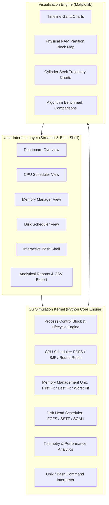

# OS Resource Manager Simulator

An enterprise-grade, interactive **Operating System Resource Manager Simulator** that comprehensively demonstrates how modern operating systems manage CPU execution, dynamic contiguous memory partitions, process lifecycles, and disk arm head movements.

Built with **Python**, **Streamlit**, **Matplotlib**, and native **Bash** shell utilities.

---

##  Architecture Overview



---

##  Features

### 1.  CPU Scheduling Engine
- **Supported Algorithms**:
  - **FCFS (First-Come, First-Served)**: Non-preemptive scheduling strictly prioritized by arrival time. Handles CPU idle intervals cleanly.
  - **SJF (Shortest Job First)**: Supports both **Non-Preemptive SJF** and **Preemptive SJF (SRTF - Shortest Remaining Time First)**.
  - **Round Robin (RR)**: Preemptive time-sliced execution with interactive time quantum ($q$) configuration.
- **Computed Metrics**:
  - **Completion Time ($CT$)**: Timestamp when process finishes execution.
  - **Turnaround Time ($TAT = CT - AT$)**: Total elapsed time from arrival to completion.
  - **Waiting Time ($WT = TAT - BT$)**: Total time process spends waiting in ready queue.
  - **Response Time ($RT$)**: Time between process arrival and first CPU time allocation.
  - **CPU Utilization ($\%$)**: $\frac{\text{Total Busy Time}}{\text{Total Execution Time}} \times 100$.
  - **System Throughput**: Completed processes per unit time.
- **Visuals**: Matplotlib Gantt Chart with idle interval tracking and per-process color tagging.

### 2.  Contiguous Memory Allocation (MMU)
- **Supported Placement Policies**:
  - **First Fit**: Allocates memory in the first available hole of sufficient size. Fastest search time.
  - **Best Fit**: Scans all free holes to find the tightest match ($\ge \text{size}$), minimizing immediate leftover fragment.
  - **Worst Fit**: Allocates memory in the largest available hole, leaving behind the largest usable remainder.
- **Operating System Concepts Simulated**:
  - **OS Kernel Reserved Space**: Protected low memory partition (e.g., lower 128 KB).
  - **Dynamic Partition Splitting**: Creates allocated segment + residual free block.
  - **Automatic Coalescing**: Merges adjacent free holes whenever a process terminates or is deallocated.
  - **Memory Compaction (Defragmentation)**: Shifts all allocated blocks contiguously towards the base address to unite all scattered fragments into one single large free block.
  - **External Fragmentation Index**: Tracks unusable free memory due to partition fragmentation.
- **Visuals**: Dynamic physical RAM address map showing hex base/end addresses and process boundaries.

### 3.Process Management & Lifecycle (PCB)
- **State Machine**:
  - Transitions: `NEW` $\to$ `READY` $\to$ `RUNNING` $\to$ `WAITING` (Paused) $\to$ `TERMINATED`.
- **Process Control Block (PCB)** fields:
  - Process ID (PID), Name, Arrival Time ($AT$), Burst Time ($BT$), Remaining Time, Memory Size, Priority, Base Address, State.
- **Controls**:
  - **Create**: Dynamically spawn processes with custom memory, burst, priority, and arrival times.
  - **Pause / Resume**: Transition processes between `READY`/`RUNNING` and `WAITING` states.
  - **Terminate**: Explicitly terminate processes and automatically free/coalesce allocated memory.

### 4.  Disk Scheduling (FCFS & SSTF)
- **Algorithms**:
  - **FCFS**: Services cylinder requests in exact order of arrival.
  - **SSTF (Shortest Seek Time First)**: Selects pending request closest to the current read/write arm position.
  - **SCAN (Elevator Algorithm)**: Sweeps across the platter servicing requests in directional passes.
- **Metrics**: Total head movements (seek count), average seek distance, seek efficiency gain percentage.
- **Visuals**: Step-by-step cylinder movement trajectory chart with track markers and downward sequence steps.

### 5.  Interactive Bash / Unix Shell Terminal
- Integrated command prompt that interprets standard Unix/Bash syntax:
  - `ps`: View process table and PCB states.
  - `top` / `htop`: Live system load, memory utilization, and active task summary.
  - `create <name> <bt> <mem> [priority]`: Fork and spawn new process.
  - `kill <pid>`: Terminate process and free memory.
  - `pause <pid>` / `resume <pid>`: Suspend or resume process execution.
  - `free`: Display memory usage and fragmentation stats.
  - `df`: Inspect disk head position and pending cylinder requests.
  - `sched <fcfs|sjf|rr> [q]`: Execute CPU scheduling on current workload.
  - `compact`: Trigger memory compaction.
  - `sysinfo` / `uname -a`: Host system information.

### 6. Analytical Reports & Data Exports
- Automated generation of Markdown performance reports.
- CSV export for process execution statistics ($AT, BT, CT, TAT, WT, RT$).
- Comparative benchmark bar charts evaluating FCFS, SJF, and Round Robin on identical workloads.

---

##  Technology Stack

| Layer | Technology | Purpose |
|---|---|---|
| **Core Engine** | Python 3 | Process simulation, CPU/Memory/Disk algorithms, metrics calculations |
| **Dashboard** | Streamlit | Responsive interactive web UI, state management, forms & telemetry |
| **Visualizations**| Matplotlib | Gantt charts, physical RAM maps, disk seek trajectory plots, comparison bars |
| **System Scripts**| Bash (`.sh`) | Process creation demonstration, system telemetry queries, automated benchmarks |

---

##  Getting Started

### 1. Installation
Clone or navigate to the project directory and install the required dependencies:
```bash
pip install -r requirements.txt
```

*(Or individually: `pip install streamlit matplotlib pandas numpy`)*

### 2. Launch the Streamlit Dashboard
```bash
streamlit run app.py
```
Open your browser at `http://localhost:8501`.

### 3. Run Automated Tests
Execute the comprehensive unit test suite:
```bash
python -m unittest tests/test_simulation.py
```

### 4. Execute Bash Scripts
If running on Linux, macOS, or Windows with Git Bash / WSL:
```bash
# Display system telemetry
bash scripts/system_info.sh

# Run process lifecycle demonstration
bash scripts/create_process.sh

# Run automated algorithmic benchmark
bash scripts/run_benchmark.sh
```

---

## Project Directory Structure

```
capstone os/
├── app.py                     # Streamlit main entry point & dashboard
├── requirements.txt           # Python package dependencies
├── README.md                  # Documentation and architecture guide
├── core/
│   ├── __init__.py
│   ├── pcb.py                 # Process Control Block & Process lifecycle states
│   ├── cpu_scheduler.py       # FCFS, SJF (Preemptive/Non-preemptive), Round Robin
│   ├── memory_manager.py      # First Fit, Best Fit, Worst Fit, Coalescing, Compaction
│   ├── disk_scheduler.py      # FCFS, SSTF, and SCAN disk head arm scheduling
│   ├── shell_interpreter.py   # Unix / Bash command line shell interpreter
│   └── metrics.py             # Performance benchmark metrics and report export
├── visualization/
│   ├── __init__.py
│   └── charts.py              # Matplotlib Gantt charts, RAM maps, Disk trajectories
├── scripts/
│   ├── system_info.sh         # Bash system information querying script
│   ├── create_process.sh      # Bash process management & lifecycle script
│   └── run_benchmark.sh       # Bash automated simulation benchmark runner
└── tests/
    └── test_simulation.py     # Automated unit test suite (13 test cases)
```

---

##  Sample Visualizations

- **CPU Scheduling Gantt Chart**: Color-coded execution intervals with timeline ticks and idle state recognition.
- **RAM Partition Map**: Displays physical address boundaries (`0x0000` to `0x0400`), reserved OS kernel space, allocated process segments, and free holes.
- **Disk Arm Trajectory Chart**: Plotted track index vs. service step showing how SSTF eliminates long seek movements compared to FCFS.

---

##  Educational Concepts Covered
1. **CPU Dispatching**: Ready queue management, context switching overheads, time quanta selection, Convoy Effect in FCFS, starvation avoidance.
2. **Memory Fragmentation**: Internal vs. External fragmentation, dynamic partitioning trade-offs (First Fit vs Best Fit vs Worst Fit), memory compaction overhead.
3. **I/O Storage Subsystems**: Disk platter mechanics, rotational delay vs seek latency, disk arm starvation in SSTF.
